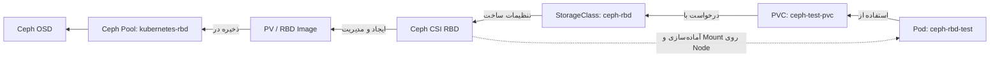

<div dir="rtl" align="right" markdown="1">

# راهنمای فارسی نصب Ceph و اتصال Kubernetes به Ceph RBD در محیط Online

> **دامنه مستند:** راه‌اندازی آزمایشگاهی یک Ceph خارجی با نسخه Squid 19.2.3، نصب Ceph CSI RBD روی Kubernetes نسخه 1.37.1، ایجاد StorageClass و PVC و آزمایش Pod؛ با این تفاوت که **سرور و نودها به اینترنت دسترسی دارند** و نیازی به Nexus داخلی نیست.
>
> **وضعیت تأییدشده:** Podهای Ceph CSI آماده شدند و Dynamic Provisioning با موفقیت انجام شد؛ PVC و PV به حالت `Bound` رسیدند. در خروجی‌های ثبت‌شده، **تست نهایی Mount و نوشتن/خواندن فایل توسط Pod هنوز تأیید نشده است**.
>
> **هشدار:** محیط اصلی این آزمایش فقط یک Ceph Server و یک OSD دارد و فاقد افزونگی داده است. این معماری برای محیط عملیاتی مناسب نیست. هیچ کلید CephX، فایل Keyring یا Secret واقعی را داخل Git قرار ندهید.

## ۱. معماری ساده



**به زبان ساده:** برنامه داخل Pod در مسیر `/data` فایل می‌نویسد. Pod از یک PVC استفاده می‌کند؛ PVC درخواست فضای ذخیره‌سازی است. StorageClass مشخص می‌کند فضای موردنظر با کدام Driver و چه تنظیماتی ایجاد شود. Ceph CSI یک RBD Image در Ceph می‌سازد، برای آن PV تعریف می‌شود و روی Node محل اجرای Pod، Volume آماده و Mount می‌شود.

**نکته مفهومی:** فلش‌های بالا مسیر درخواست و اتصال را ساده‌سازی می‌کنند؛ PVC، PV و StorageClass مسیر عبور مستقیم داده نیستند. عملیات ورودی/خروجی واقعی از فایل‌سیستم Mountشده روی Node به دیسک RBD و OSDهای Ceph انجام می‌شود.

| مؤلفه | مقدار در آزمایش | کاربرد |
|---|---|---|
| سرور Ceph / MON | `192.168.72.50:3300` | سرویس ذخیره‌سازی خارجی |
| نسخه Ceph | `Squid 19.2.3` | Backend ذخیره‌سازی |
| شناسه Cluster یا FSID | `47716fd6-db2e-11f1-a7eb-005056995454` | شناسه Ceph در تنظیمات CSI |
| Pool | `kubernetes-rbd` | نگهداری RBD Imageها |
| نسخه Kubernetes | `v1.37.1` | کلاستر مصرف‌کننده Storage |
| Image اصلی Ceph CSI | `quay.io/cephcsi/cephcsi:v3.18.2-rocky9` | Driver سازگار با CPU قدیمی |
| StorageClass | `ceph-rbd` | تنظیمات Dynamic Provisioning |
| PVC | `ceph-test/ceph-test-pvc` | درخواست یک گیگابایت، `RWO` |
| Pod آزمایشی | `ceph-test/ceph-rbd-test` | تست Mount و فایل |

> IPها، نام Nodeها، دیسک و FSID را برای محیط جدید تغییر دهید. در این راهنمای Online، Imageها از Registryهای عمومی دریافت می‌شوند.

## ۲. پیش‌نیازها

- یک سرور Linux برای Ceph با دسترسی مدیریتی، اینترنت، `systemd`، تنظیم صحیح زمان، `Podman` و `LVM2`.
- یک دیسک خالی و اختصاصی برای OSD. **هرگز دیسک سیستم‌عامل یا دیسک دارای داده را انتخاب نکنید.**
- کلاستر Kubernetes در دسترس، `kubectl` و `Helm` و دسترسی لازم برای نصب CSI Node Plugin.
- دسترسی شبکه تمام Nodeهای موردنیاز به MON و OSDهای Ceph؛ فقط باز بودن پورت MON کافی نیست.
- بررسی سازگاری نسخه دقیق Kubernetes و Ceph CSI. ترکیب Kubernetes `v1.37.1` و CSI `v3.18.2` صرفاً در سطح نتایج آزمایش حاضر اعتبارسنجی شده، نه برای Production.

### علت انتخاب Image مخصوص CPU قدیمی

نودهای آزمایش از CPU مجازی‌شده `Intel Xeon E7-4870` استفاده می‌کردند که قابلیت‌های `AVX` و `AVX2` را نداشت. Image استاندارد Ceph CSI `v3.18.1` با خطای زیر متوقف می‌شد:

```text
Fatal glibc error: CPU does not support x86-64-v3
```

با استفاده از Image جایگزین Rocky Linux 9 یعنی `v3.18.2-rocky9`، Containerهای CSI با موفقیت اجرا شدند. این Variant برای چنین CPUهایی مناسب‌تر است، ولی باید یادداشت‌های Release و وضعیت پشتیبانی آن بررسی شود.

## ۳. نصب Ceph Squid روی سرور دارای اینترنت

دستورهای این بخش برای **آزمایشگاه تک‌سروری** هستند. روی **سرور Ceph** اجرا کنید.

```bash
sudo apt-get update
sudo apt-get install -y podman lvm2 chrony curl ca-certificates
sudo systemctl enable --now chrony
```

ابزار `cephadm` را از مسیر رسمی سازگار با Ceph Squid نصب کنید. اگر Repository سیستم‌عامل پکیج مناسب را دارد:

```bash
sudo apt-get install -y cephadm
cephadm version
```

اگر پکیج موجود نیست یا نسخه درست نیست، طبق [راهنمای رسمی نصب cephadm برای Squid](https://docs.ceph.com/en/squid/cephadm/install/) مخزن مناسب را تنظیم کنید؛ روش‌های نصب ناسازگار را ترکیب نکنید.

Bootstrap کلاستر:

```bash
sudo cephadm bootstrap \
  --mon-ip 192.168.72.50 \
  --image quay.io/ceph/ceph:v19.2.3
```

بررسی سلامت سرویس‌ها:

```bash
sudo cephadm shell -- ceph -s
sudo cephadm shell -- ceph orch ps
sudo cephadm shell -- ceph fsid
```

این فرایند MON و MGR اولیه را راه‌اندازی می‌کند. استفاده از Dashboard اختیاری است؛ دسترسی به آن را محدود و گواهی TLS معتبر تنظیم کنید.

## ۴. راه‌اندازی OSD

**روش پیشنهادی برای Online:** یک دیسک خالی و مستقل به سرور اختصاص دهید.

```bash
lsblk -o NAME,SIZE,TYPE,FSTYPE,MOUNTPOINTS
sudo cephadm shell -- ceph orch device ls
sudo cephadm shell -- ceph orch host ls
```

فقط در صورتی که `/dev/sdb` واقعاً یک دیسک خالی و اختصاصی باشد:

```bash
sudo cephadm shell -- ceph orch daemon add osd ceph:/dev/sdb
sudo cephadm shell -- ceph osd tree
sudo cephadm shell -- ceph -s
```

در صورت تفاوت نام Host، به‌جای `ceph` نام واقعی نمایش‌داده‌شده در `ceph orch host ls` را قرار دهید. **دستور ایجاد OSD اطلاعات قبلی دیسک انتخابی را از بین می‌برد.**

### تفاوت با آزمایشگاه واقعی ما

در محیط اولیه امکان افزودن دیسک جدید وجود نداشت؛ بنابراین یک فایل Sparse به Loop Device متصل شد و از طریق LVM یک OSD آزمایشی ساخته شد. همچنین یک Helper مبتنی بر `systemd` برای فعال‌سازی دوباره Loop و VG بعد از Restart تنظیم شد. Reboot کامل انجام شد و OSD در وضعیت `up/in` برگشت.

این راهکار فقط برای محدودیت سخت‌افزاری همان Lab بود؛ **برای سرور Online دارای دیسک اختصاصی، از دیسک واقعی استفاده کنید**.

### تنظیم Replication برای محیط تک‌OSD

در محیطی با فقط یک OSD، Pool با Replication سه‌تایی قابل استفاده نیست. برای Lab غیرحساس می‌توان `size=1` و `min_size=1` تنظیم کرد. در این حالت داده‌ها **هیچ نسخه پشتیبانی در Ceph ندارند** و نمایش هشدار Health طبیعی است.

## ۵. ایجاد RBD Pool و کاربر CephX

دستورها روی سرور Ceph:

```bash
sudo cephadm shell -- ceph osd pool create kubernetes-rbd 32
sudo cephadm shell -- ceph osd pool application enable kubernetes-rbd rbd
sudo cephadm shell -- rbd pool init kubernetes-rbd
```

**فقط برای Lab تک‌OSD:**

```bash
sudo cephadm shell -- ceph osd pool set kubernetes-rbd size 1
sudo cephadm shell -- ceph osd pool set kubernetes-rbd min_size 1
```

بررسی:

```bash
sudo cephadm shell -- ceph osd pool ls detail
sudo cephadm shell -- ceph -s
```

برای CSI یک کاربر اختصاصی با دسترسی محدود به Pool بسازید؛ از `client.admin` استفاده نکنید:

```bash
sudo cephadm shell -- ceph auth get-or-create client.kubernetes-rbd \
  mon 'profile rbd' \
  osd 'profile rbd pool=kubernetes-rbd' \
  mgr 'profile rbd pool=kubernetes-rbd'
```

**کلید برگشتی را منتشر نکنید.** اگر کلید قبلاً افشا شده، طبق روش پشتیبانی‌شده در نسخه Ceph آن را Rotate یا جایگزین کنید. اگر Client فعالی از آن استفاده می‌کند، تغییر کلید باید با برنامه‌ریزی باشد.

دریافت کلید در یک فایل محافظت‌شده:

```bash
umask 077
sudo cephadm shell -- ceph auth get-key client.kubernetes-rbd > /root/kubernetes-rbd.key
chmod 600 /root/kubernetes-rbd.key
```

فایل را از طریق کانال امن مانند SCP به ماشین مدیریتی Kubernetes منتقل کنید و بعد از ساخت Secret، فایل موقت را حذف کنید. **کلید را در README یا Repository ذخیره نکنید.**

## ۶. نصب Ceph CSI RBD با Helm در محیط Online

> **توجه به چرخه عمر:** در شاخه Ceph CSI `v3.18` نصب با Helm در مسیر Deprecated قرار گرفته و پروژه برای نسخه‌های بعدی استفاده از Ceph-CSI Operator را توصیه کرده است. این مستند روش Helm را توضیح می‌دهد، چون در آزمایشگاه ما از همین روش استفاده شد. برای محیط Production مسیر Operator را نیز ارزیابی کنید.

روی Master یا ماشین مدیریتی Kubernetes:

```bash
sudo apt-get update
sudo apt-get install -y git unzip
helm version
kubectl get nodes -o wide
```

دانلود سورس نسخه مشخص Ceph CSI از اینترنت:

```bash
mkdir -p ~/ceph-csi-demo && cd ~/ceph-csi-demo
curl -fL -o ceph-csi-v3.18.2.zip \
  https://github.com/ceph/ceph-csi/archive/refs/tags/v3.18.2.zip
unzip -q ceph-csi-v3.18.2.zip
CHART="$HOME/ceph-csi-demo/ceph-csi-3.18.2/charts/ceph-csi-rbd"
helm show chart "$CHART"
```

در آزمایش واقعی، Chart از سورس `v3.18.1` بود و Image اصلی Driver به `v3.18.2-rocky9` تغییر کرد. برای راهنمای قابل بازتولید Online، سورس Chart هم به `v3.18.2` ارتقا داده شده است؛ **این ترکیب دقیق Chart/Image هنوز باید به‌صورت End-to-End آزمایش شود.**

فایل `values-ceph-rbd.yaml` را بسازید:

```yaml
csiConfig:
  - clusterID: "47716fd6-db2e-11f1-a7eb-005056995454"
    monitors:
      - "192.168.72.50:3300"

nodeplugin:
  plugin:
    image:
      repository: quay.io/cephcsi/cephcsi
      tag: v3.18.2-rocky9
      pullPolicy: IfNotPresent

provisioner:
  replicaCount: 2
  plugin:
    image:
      repository: quay.io/cephcsi/cephcsi
      tag: v3.18.2-rocky9
      pullPolicy: IfNotPresent

storageClass:
  create: false
secret:
  create: false
volumeSnapshotClass:
  create: false
```

نسخه Sidecarها از مقادیر پیش‌فرض Chart گرفته می‌شود. **قبل از نصب، تمام Image Referenceها را بررسی کنید**:

```bash
helm lint "$CHART" -f values-ceph-rbd.yaml
helm template ceph-csi-rbd "$CHART" -n ceph-csi \
  -f values-ceph-rbd.yaml > rendered-ceph-rbd.yaml
grep -E '^[[:space:]]*image:' rendered-ceph-rbd.yaml | sort -u
```

نصب با Helm:

```bash
helm upgrade --install ceph-csi-rbd "$CHART" \
  -n ceph-csi --create-namespace \
  -f values-ceph-rbd.yaml --wait --timeout 10m

kubectl get pods -n ceph-csi -o wide
kubectl get deployments,daemonsets -n ceph-csi
kubectl get csidrivers
helm status ceph-csi-rbd -n ceph-csi
```

**نتیجه واقعی Lab:** سه Pod از نوع Node Plugin به `3/3 Running` و دو Pod Provisioner به `7/7 Running` رسیدند؛ Driver با نام `rbd.csi.ceph.com` ثبت شد.

## ۷. ساخت Kubernetes Secret برای CephX

فرض می‌کنیم فایل کلید خصوصی، در مسیر `/root/kubernetes-rbd.key` روی ماشین مدیریت Kubernetes موجود و در صورت نیاز Rotate شده است.

```bash
chmod 600 /root/kubernetes-rbd.key
kubectl create namespace ceph-csi --dry-run=client -o yaml | kubectl apply -f -

kubectl create secret generic csi-rbd-secret \
  -n ceph-csi \
  --from-literal=userID=kubernetes-rbd \
  --from-file=userKey=/root/kubernetes-rbd.key \
  --dry-run=client -o yaml | kubectl apply -f -

kubectl get secret csi-rbd-secret -n ceph-csi
rm -f /root/kubernetes-rbd.key
```

Secret شامل دو مقدار `userID` و `userKey` است. مقدار `userKey` را در Git قرار ندهید. در محیط حساس، RBAC محدود و Encryption at Rest برای Kubernetes Secrets فعال باشد.

## ۸. ساخت StorageClass

StorageClass از نوع **Cluster-scoped** است؛ یعنی به Namespace خاصی تعلق ندارد. فایل `storageclass.yaml`:

```yaml
apiVersion: storage.k8s.io/v1
kind: StorageClass
metadata:
  name: ceph-rbd
provisioner: rbd.csi.ceph.com
parameters:
  clusterID: "47716fd6-db2e-11f1-a7eb-005056995454"
  pool: kubernetes-rbd
  imageFeatures: layering
  csi.storage.k8s.io/fstype: ext4
  csi.storage.k8s.io/provisioner-secret-name: csi-rbd-secret
  csi.storage.k8s.io/provisioner-secret-namespace: ceph-csi
  csi.storage.k8s.io/controller-expand-secret-name: csi-rbd-secret
  csi.storage.k8s.io/controller-expand-secret-namespace: ceph-csi
  csi.storage.k8s.io/controller-publish-secret-name: csi-rbd-secret
  csi.storage.k8s.io/controller-publish-secret-namespace: ceph-csi
  csi.storage.k8s.io/node-stage-secret-name: csi-rbd-secret
  csi.storage.k8s.io/node-stage-secret-namespace: ceph-csi
reclaimPolicy: Delete
allowVolumeExpansion: true
volumeBindingMode: Immediate
```

اعمال و بررسی:

```bash
kubectl apply -f storageclass.yaml
kubectl get storageclass
```

**خطایی که دیدیم:** PVC حدود ۲۱ ساعت `Pending` بود و پیغام `storageclass.storage.k8s.io "ceph-rbd" not found` دریافت می‌کرد. پس از ایجاد StorageClass، همان PVC قبلی بدون حذف و ایجاد مجدد به `Bound` تغییر وضعیت داد.

## ۹. ساخت PVC و Dynamic Provisioning

فایل `test-pvc.yaml`:

```yaml
apiVersion: v1
kind: Namespace
metadata:
  name: ceph-test
---
apiVersion: v1
kind: PersistentVolumeClaim
metadata:
  name: ceph-test-pvc
  namespace: ceph-test
spec:
  accessModes:
    - ReadWriteOnce
  storageClassName: ceph-rbd
  resources:
    requests:
      storage: 1Gi
```

اعمال و بررسی:

```bash
kubectl apply -f test-pvc.yaml
kubectl get pvc -n ceph-test
kubectl get pv
kubectl describe pvc ceph-test-pvc -n ceph-test
```

**وضعیت موفق ثبت‌شده در محیط واقعی:**

```text
ceph-test-pvc   Bound   pvc-8e1e1099-f8d4-4f5f-b847-2ce6fcd4f81a   1Gi   RWO   ceph-rbd
```

برای بررسی RBD Image روی سرور Ceph:

```bash
sudo cephadm shell -- rbd ls -p kubernetes-rbd
```

یعنی Ceph CSI توانسته یک Volume ایجاد کند و Kubernetes برای آن PV بسازد؛ اما این نتیجه به‌تنهایی موفقیت Mount روی Node را اثبات نمی‌کند.

## ۱۰. ساخت Pod و تست Mount / Read / Write

در محیط **Online** از Image عمومی BusyBox استفاده می‌کنیم. در فیلد `image` نباید `http://` یا `https://` قرار گیرد.

فایل `test-pod.yaml`:

```yaml
apiVersion: v1
kind: Pod
metadata:
  name: ceph-rbd-test
  namespace: ceph-test
spec:
  nodeSelector:
    kubernetes.io/hostname: worker1
  restartPolicy: Never
  containers:
    - name: test
      image: docker.io/library/busybox:1.36
      imagePullPolicy: IfNotPresent
      command: ["sh", "-c", "sleep 36000"]
      volumeMounts:
        - name: ceph-volume
          mountPath: /data
  volumes:
    - name: ceph-volume
      persistentVolumeClaim:
        claimName: ceph-test-pvc
```

> در این مثال فرض شده Label مربوط به Node مقدار `kubernetes.io/hostname=worker1` دارد. ابتدا `kubectl get nodes --show-labels` را بررسی کنید. اگر می‌خواهید Scheduler خودش Node را انتخاب کند، `nodeSelector` را حذف کنید.

```bash
kubectl apply -f test-pod.yaml
kubectl get pods -n ceph-test -o wide
kubectl describe pod ceph-rbd-test -n ceph-test
```

بعد از اینکه Pod در وضعیت `Running` قرار گرفت، عملیات نوشتن و خواندن را تست کنید:

```bash
kubectl exec -n ceph-test ceph-rbd-test -- \
  sh -c 'echo "Ceph CSI RBD works" > /data/test.txt'

kubectl exec -n ceph-test ceph-rbd-test -- cat /data/test.txt
kubectl exec -n ceph-test ceph-rbd-test -- df -h /data
```

### تست ماندگاری فایل پس از حذف Pod

**PVC را حذف نکنید.** فقط Pod آزمایشی را مجدداً ایجاد کنید:

```bash
kubectl delete pod ceph-rbd-test -n ceph-test
kubectl apply -f test-pod.yaml
kubectl wait --for=condition=Ready pod/ceph-rbd-test \
  -n ceph-test --timeout=180s
kubectl exec -n ceph-test ceph-rbd-test -- cat /data/test.txt
```

اگر فایل قبلی هنوز وجود داشت، Persistence تأیید می‌شود.

**وضعیت ثبت‌شده:** آخرین Pod آزمایشی در گفت‌وگوی اصلی به‌دلیل وارد کردن `http://` داخل `image` با `InvalidImageName` مواجه شد. دستور اصلاح داده شد، اما خروجی موفق `Running` و نتیجه تست Write/Read/Persistence ارسال نشد؛ بنابراین این سه مورد هنوز **نیازمند تأیید** هستند.

## ۱۱. عیب‌یابی مشکلاتی که در پروژه داشتیم

| خطا | علت و راهکار |
|---|---|
| `ImagePullBackOff` | در Lab آفلاین، دسترسی Containerd به Registry HTTP مشکل داشت؛ در سناریوی Online، DNS، TLS و دسترسی خروجی Nodeها به Registry عمومی را بررسی کنید. |
| `CrashLoopBackOff` با Exit Code `127` | Image معمولی Ceph CSI به `x86-64-v3` نیاز داشت و CPU قدیمی AVX/AVX2 نداشت؛ با `v3.18.2-rocky9` برطرف شد. |
| Crash شدن Sidecarها | وقتی Driver اصلی اجرا نشود، CSI Socket آماده نیست و Sidecarها نیز خطا می‌دهند؛ اول لاگ `csi-rbdplugin` را بخوانید. |
| `StorageClass "ceph-rbd" not found` | StorageClass هنوز ساخته نشده بود؛ پس از `kubectl apply -f storageclass.yaml` درخواست PVC موفق شد. |
| `PVC Pending` | Eventهای PVC، لاگ Provisioner، StorageClass و Secret را بررسی کنید. |
| `InvalidImageName` | وجود `http://` در نام Image؛ مقدار صحیح باید مثل `docker.io/library/busybox:1.36` باشد. |
| `ContainerCreating` طولانی | Eventهای Mount، لاگ CSI Node Plugin، دسترسی به MON/OSD و پشتیبانی Kernel RBD را بررسی کنید. |

دستورهای عیب‌یابی:

```bash
kubectl get pods -n ceph-csi -o wide
kubectl get events -n ceph-csi --sort-by=.lastTimestamp | tail -30
kubectl get pvc -n ceph-test
kubectl describe pvc ceph-test-pvc -n ceph-test
kubectl describe pod ceph-rbd-test -n ceph-test
kubectl logs -n ceph-csi -l component=nodeplugin \
  -c csi-rbdplugin --tail=60 --prefix=true
```

## ۱۲. نکات امنیتی و عملیاتی

1. **یک OSD یعنی بدون افزونگی.** خرابی دیسک یا سرور ممکن است تمام داده‌ها را از بین ببرد. برای Production به چند OSD و Fault Domain مستقل نیاز داریم.
2. کاربر CephX باید فقط به Pool موردنیاز دسترسی داشته باشد. Credential را در Git ذخیره نکنید.
3. مسیر شبکه Kubernetes به MON و OSDها را محدود و کنترل کنید؛ داده فقط از پورت `3300` عبور نمی‌کند.
4. `ReadWriteOnce` به معنی محدودیت Mount به یک Node در یک زمان است؛ این Volume معادل فضای اشتراکی ReadWriteMany نیست.
5. در `reclaimPolicy: Delete`، حذف PVC می‌تواند باعث حذف RBD Image و داده‌های آن شود.
6. برای محیط جدید و بلندمدت، مسیر Ceph-CSI Operator را بررسی کنید؛ Helm Chart در شاخه `v3.18` Deprecated اعلام شده است.
7. پیش از استفاده عملیاتی، سازگاری نسخه‌ها، وضعیت Backup/Restore و تست کامل End-to-End را بررسی کنید.

## ۱۳. چک‌لیست وضعیت پروژه

- [x] نصب Ceph و آماده‌شدن MON و MGR
- [x] ساخت OSD آزمایشگاهی و تأیید بالا آمدن مجدد پس از Reboot
- [x] ساخت و آماده‌سازی Pool به نام `kubernetes-rbd`
- [x] نصب Ceph CSI و Running شدن Node Plugin و Provisioner
- [x] ساخت StorageClass به نام `ceph-rbd`
- [x] ساخت PVC و اتصال موفق آن به PV داینامیک (`Bound`)
- [ ] اجرای موفق Pod با Mount مسیر `/data` — هنوز نتیجه ثبت نشده
- [ ] تأیید خواندن و نوشتن فایل روی Volume
- [ ] تأیید ماندگاری فایل پس از حذف و ساخت مجدد Pod
- [ ] ارزیابی افزونگی و تحمل خرابی برای Production — خارج از دامنه Lab تک‌OSD

## منابع

- [نصب cephadm در Ceph Squid](https://docs.ceph.com/en/squid/cephadm/install/)
- [مستندات Ceph RBD CSI](https://docs.ceph.com/en/latest/csi/rbd/)
- [مخزن رسمی Ceph CSI و Image سازگار Rocky 9](https://github.com/ceph/ceph-csi)
- [مقادیر Helm Chart نسخه v3.18.2](https://github.com/ceph/ceph-csi/blob/v3.18.2/charts/ceph-csi-rbd/values.yaml)
- [Releaseها و وضعیت Helm](https://github.com/ceph/ceph-csi/releases)
- [نمونه StorageClass رسمی](https://github.com/ceph/ceph-csi/blob/devel/examples/rbd/storageclass.yaml)

</div>
