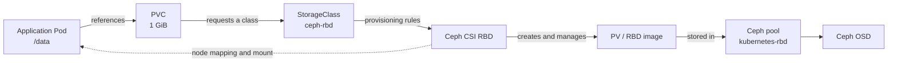

# Kubernetes Persistent Storage with Ceph RBD (Online Lab Guide)

> **Scope:** Reproducible, internet-connected lab deployment of an external Ceph Squid cluster, Ceph CSI RBD on Kubernetes, and an example Pod/PVC. Based on a working lab with Ceph 19.2.3, Kubernetes 1.37.1, and Ceph CSI image `v3.18.2-rocky9`.
>
> **Status:** Ceph CSI Pods were Ready; dynamic provisioning succeeded (PVC and PV `Bound`). The final application Pod mount and read/write test **has not yet been confirmed** in the recorded session.
>
> **Safety:** The demonstrated storage design uses one Ceph host / one OSD and has **no data redundancy**. It is for a disposable lab, not production. Do not commit CephX keys, admin keyrings, or Kubernetes Secret values to Git.

## 1. Architecture at a glance



**Read this as a concept diagram, not a data-plane path.** PVC, PV, and StorageClass are Kubernetes API objects, not networking hops. The CSI controller provisions the RBD image; the CSI node plugin and kubelet map/mount the block device on the selected node; application I/O goes through the mounted filesystem to Ceph OSDs.

| Component | Lab name / value | Purpose |
|---|---|---|
| Ceph host / MON | `192.168.72.50`, MON v2 port `3300` | External block storage cluster |
| Ceph release | Squid `19.2.3` | Storage backend |
| Ceph FSID | `47716fd6-db2e-11f1-a7eb-005056995454` | Ceph CSI cluster ID |
| RBD pool | `kubernetes-rbd` | Holds dynamically provisioned images |
| Kubernetes | `v1.37.1` | Consumer of persistent storage |
| Ceph CSI image | `quay.io/cephcsi/cephcsi:v3.18.2-rocky9` | Driver image for older x86 CPUs |
| StorageClass | `ceph-rbd` | Dynamic provisioning configuration |
| PVC | `ceph-test/ceph-test-pvc`, `1Gi`, `RWO` | App's storage request |
| Pod | `ceph-test/ceph-rbd-test` | Validation workload |

> Replace IP addresses, FSID, hostnames and device names if reusing the example in another environment. For an online setup, all images are pulled directly from public registries; no private Nexus mirror is needed.

## 2. Prerequisites

- A Linux host for Ceph with root/sudo, internet access, Python 3, systemd, time synchronization, Podman or Docker, and LVM2.
- A dedicated unused block device for the OSD (preferred). **Never use the root disk or a disk containing data.**
- A reachable Kubernetes cluster, with `kubectl`, Helm, sufficient permissions to deploy privileged CSI node plugins, and supported kernel RBD facilities.
- Kubernetes nodes must be able to reach the Ceph MON and OSD network ports (the MON alone is not enough).
- Check compatibility for the exact Kubernetes/Ceph-CSI release combination. The v1.37.1 and CSI v3.18.2 pairing was validated only to the extent documented here; it is **not a production certification**.

### CPU compatibility note from this lab

The Kubernetes nodes ran virtualized **Intel Xeon E7-4870** processors without AVX/AVX2. The standard Ceph CSI v3.18.1 image failed immediately with:

```text
Fatal glibc error: CPU does not support x86-64-v3
```

The alternative Rocky Linux 9 image `v3.18.2-rocky9` ran successfully. For hosts that support x86-64-v3, the standard image may be suitable. If using older CPUs, retain the `-rocky9` image tag and check the project's release notes.

## 3. Install Ceph Squid on an internet-connected host

The following commands illustrate a **single-host lab**. Use the official Ceph Squid package documentation and verify package versions before bootstrapping. Run on the Ceph server.

```bash
sudo apt-get update
sudo apt-get install -y podman lvm2 chrony curl ca-certificates
sudo systemctl enable --now chrony
```

Acquire the Cephadm tool using **one** official installation route. On Ubuntu with an appropriate Ceph package source available:

```bash
sudo apt-get install -y cephadm
cephadm version
```

If the distribution's `cephadm` package is unavailable or not the intended release, follow the [official Ceph Squid cephadm installation page](https://docs.ceph.com/en/squid/cephadm/install/) to install the matching version; do **not** mix distribution and curl-based bootstrap methods.

Bootstrap the Ceph cluster:

```bash
sudo cephadm bootstrap \
  --mon-ip 192.168.72.50 \
  --image quay.io/ceph/ceph:v19.2.3
```

Verify services. If the `ceph` CLI is not installed on the host, use `sudo cephadm shell -- ceph ...` instead:

```bash
sudo cephadm shell -- ceph -s
sudo cephadm shell -- ceph orch ps
sudo cephadm shell -- ceph fsid
```

The bootstrap deploys the first MON and MGR services. The dashboard is optional and should be secured with a valid certificate and restricted access.

## 4. Create the Ceph OSD

**Preferred online-lab method: use a dedicated blank disk.** Check the disk carefully:

```bash
lsblk -o NAME,SIZE,TYPE,FSTYPE,MOUNTPOINTS
sudo cephadm shell -- ceph orch device ls
```

For example, **only if `/dev/sdb` is a confirmed blank, dedicated disk**:

```bash
sudo cephadm shell -- ceph orch daemon add osd ceph:/dev/sdb
sudo cephadm shell -- ceph osd tree
sudo cephadm shell -- ceph -s
```

Change `ceph` to the actual `ceph orch host ls` hostname. The command **destroys existing content** on the selected OSD device.

### What was done in the original constrained lab

The real lab did not have a second physical/virtual disk, so a sparse image file was attached as a loop device, a VG/LV was created, and Ceph BlueStore used the LV as an OSD. An idempotent systemd pre-start helper reattached the loop device and activated the VG after reboot. A full reboot was tested, and the OSD remained `up/in` with PGs `active+clean`.

That loopback configuration was a workaround for the original disk constraints. **It is deliberately not the default procedure here**: on an online machine with appropriate storage, prefer a real dedicated OSD device.

### Replica setting for a one-OSD lab only

With exactly one OSD, a replicated pool cannot use size 3. For an explicitly disposable single-OSD lab, configure the intended pool with `size=1`, `min_size=1`. This removes data redundancy and may produce an intentional Ceph health warning.

## 5. Create the RBD pool and CephX client

Run on the Ceph host (commands below use `cephadm shell`).

```bash
sudo cephadm shell -- ceph osd pool create kubernetes-rbd 32
sudo cephadm shell -- ceph osd pool application enable kubernetes-rbd rbd
sudo cephadm shell -- rbd pool init kubernetes-rbd
```

For a **one-OSD lab only**:

```bash
sudo cephadm shell -- ceph osd pool set kubernetes-rbd size 1
sudo cephadm shell -- ceph osd pool set kubernetes-rbd min_size 1
```

Check:

```bash
sudo cephadm shell -- ceph osd pool ls detail
sudo cephadm shell -- ceph -s
```

Create a scoped CSI user (do not use `client.admin` for workloads):

```bash
sudo cephadm shell -- ceph auth get-or-create client.kubernetes-rbd \
  mon 'profile rbd' \
  osd 'profile rbd pool=kubernetes-rbd' \
  mgr 'profile rbd pool=kubernetes-rbd'
```

> **Do not publish the returned secret key.** For an existing lab user whose key was exposed, rotate or replace it following the Ceph release's supported procedure **before** creating the Kubernetes Secret. Back up and plan the change if clients already use it.

Create a private key file on the Ceph host (do not print it to the terminal or commit it):

```bash
umask 077
sudo cephadm shell -- ceph auth get-key client.kubernetes-rbd > /root/kubernetes-rbd.key
chmod 600 /root/kubernetes-rbd.key
```

Transfer the key privately to a trusted Kubernetes admin machine, for example using SCP over SSH. Ensure the file is deleted after Kubernetes Secret creation.

## 6. Install Ceph CSI RBD with Helm (online Kubernetes cluster)

> **Lifecycle note:** The Ceph-CSI project says Helm chart deployments are deprecated in the v3.18 line in favor of Ceph-CSI Operator, and Helm charts are planned for removal in v3.19. These commands document the **Helm-based lab that was actually used**. For a new long-lived production deployment, review the operator migration path.

On the Kubernetes administration machine:

```bash
sudo apt-get update
sudo apt-get install -y git unzip
helm version
kubectl get nodes -o wide
```

Get **the versioned upstream chart source** over the internet:

```bash
mkdir -p ~/ceph-csi-demo && cd ~/ceph-csi-demo
curl -fL -o ceph-csi-v3.18.2.zip \
  https://github.com/ceph/ceph-csi/archive/refs/tags/v3.18.2.zip
unzip -q ceph-csi-v3.18.2.zip
CHART="$HOME/ceph-csi-demo/ceph-csi-3.18.2/charts/ceph-csi-rbd"
helm show chart "$CHART"
```

The originally tested release used the v3.18.1 source chart together with the newer `v3.18.2-rocky9` image. This online guide uses the **matching v3.18.2 chart source** for a cleaner reproducible deployment; its exact end-to-end combination should still be tested before deployment beyond a lab.

Create a `values-ceph-rbd.yaml` file:

```yaml
csiConfig:
  - clusterID: "47716fd6-db2e-11f1-a7eb-005056995454"
    monitors:
      - "192.168.72.50:3300"

nodeplugin:
  plugin:
    image:
      repository: quay.io/cephcsi/cephcsi
      tag: v3.18.2-rocky9
      pullPolicy: IfNotPresent

provisioner:
  replicaCount: 2
  plugin:
    image:
      repository: quay.io/cephcsi/cephcsi
      tag: v3.18.2-rocky9
      pullPolicy: IfNotPresent

storageClass:
  create: false
secret:
  create: false
volumeSnapshotClass:
  create: false
```

The upstream chart defaults supply the CSI sidecars. Verify all rendered image references and their compatibility rather than guessing tags:

```bash
helm lint "$CHART" -f values-ceph-rbd.yaml
helm template ceph-csi-rbd "$CHART" -n ceph-csi \
  -f values-ceph-rbd.yaml > rendered-ceph-rbd.yaml
grep -E '^[[:space:]]*image:' rendered-ceph-rbd.yaml | sort -u
```

Install:

```bash
helm upgrade --install ceph-csi-rbd "$CHART" \
  -n ceph-csi --create-namespace \
  -f values-ceph-rbd.yaml --wait --timeout 10m

kubectl get pods -n ceph-csi -o wide
kubectl get deployments,daemonsets -n ceph-csi
kubectl get csidrivers
helm status ceph-csi-rbd -n ceph-csi
```

**Lab outcome:** three node-plugin Pods reached `3/3 Running`; two provisioner Pods reached `7/7 Running`; the CSI driver `rbd.csi.ceph.com` was registered.

## 7. Create the CephX Kubernetes Secret

The example below assumes the private key file is already on the Kubernetes administration host at `/root/kubernetes-rbd.key` and has been rotated if necessary.

```bash
chmod 600 /root/kubernetes-rbd.key
kubectl create namespace ceph-csi --dry-run=client -o yaml | kubectl apply -f -

kubectl create secret generic csi-rbd-secret \
  -n ceph-csi \
  --from-literal=userID=kubernetes-rbd \
  --from-file=userKey=/root/kubernetes-rbd.key \
  --dry-run=client -o yaml | kubectl apply -f -

kubectl get secret csi-rbd-secret -n ceph-csi
rm -f /root/kubernetes-rbd.key
```

The `csi-rbd-secret` contains `userID` and `userKey`; never commit it as a literal Secret manifest to Git. Use encryption at rest for Kubernetes Secrets and strict RBAC in real deployments.

## 8. Create the StorageClass

The StorageClass is **cluster scoped**, so it does not belong to a namespace. Save as `storageclass.yaml`:

```yaml
apiVersion: storage.k8s.io/v1
kind: StorageClass
metadata:
  name: ceph-rbd
provisioner: rbd.csi.ceph.com
parameters:
  clusterID: "47716fd6-db2e-11f1-a7eb-005056995454"
  pool: kubernetes-rbd
  imageFeatures: layering
  csi.storage.k8s.io/fstype: ext4
  csi.storage.k8s.io/provisioner-secret-name: csi-rbd-secret
  csi.storage.k8s.io/provisioner-secret-namespace: ceph-csi
  csi.storage.k8s.io/controller-expand-secret-name: csi-rbd-secret
  csi.storage.k8s.io/controller-expand-secret-namespace: ceph-csi
  csi.storage.k8s.io/controller-publish-secret-name: csi-rbd-secret
  csi.storage.k8s.io/controller-publish-secret-namespace: ceph-csi
  csi.storage.k8s.io/node-stage-secret-name: csi-rbd-secret
  csi.storage.k8s.io/node-stage-secret-namespace: ceph-csi
reclaimPolicy: Delete
allowVolumeExpansion: true
volumeBindingMode: Immediate
```

Apply:

```bash
kubectl apply -f storageclass.yaml
kubectl get storageclass
```

**Recorded issue and resolution:** the PVC stayed `Pending` with `storageclass.storage.k8s.io "ceph-rbd" not found` until this StorageClass was created. Once created, the existing PVC transitioned to `Bound` without being recreated.

## 9. Create the PVC (dynamic provisioning)

Save as `test-pvc.yaml`:

```yaml
apiVersion: v1
kind: Namespace
metadata:
  name: ceph-test
---
apiVersion: v1
kind: PersistentVolumeClaim
metadata:
  name: ceph-test-pvc
  namespace: ceph-test
spec:
  accessModes:
    - ReadWriteOnce
  storageClassName: ceph-rbd
  resources:
    requests:
      storage: 1Gi
```

```bash
kubectl apply -f test-pvc.yaml
kubectl get pvc -n ceph-test
kubectl get pv
kubectl describe pvc ceph-test-pvc -n ceph-test
```

Recorded successful state:

```text
ceph-test-pvc   Bound   pvc-8e1e1099-f8d4-4f5f-b847-2ce6fcd4f81a   1Gi   RWO   ceph-rbd
```

On the Ceph host, confirm that an RBD image exists:

```bash
sudo cephadm shell -- rbd ls -p kubernetes-rbd
```

## 10. Test mounting the PVC in a Pod

On an **online** Kubernetes cluster, use the public BusyBox image and **do not** prefix an image reference with `http://` or `https://`.

Save as `test-pod.yaml`:

```yaml
apiVersion: v1
kind: Pod
metadata:
  name: ceph-rbd-test
  namespace: ceph-test
spec:
  nodeSelector:
    kubernetes.io/hostname: worker1
  restartPolicy: Never
  containers:
    - name: test
      image: docker.io/library/busybox:1.36
      imagePullPolicy: IfNotPresent
      command: ["sh", "-c", "sleep 36000"]
      volumeMounts:
        - name: ceph-volume
          mountPath: /data
  volumes:
    - name: ceph-volume
      persistentVolumeClaim:
        claimName: ceph-test-pvc
```

> The node selector assumes the Kubernetes node label `kubernetes.io/hostname=worker1`; verify with `kubectl get nodes --show-labels`. Omit the selector to let Kubernetes schedule the test Pod automatically.

```bash
kubectl apply -f test-pod.yaml
kubectl get pods -n ceph-test -o wide
kubectl describe pod ceph-rbd-test -n ceph-test
```

Wait until `Running`, then test write/read:

```bash
kubectl exec -n ceph-test ceph-rbd-test -- \
  sh -c 'echo "Ceph CSI RBD works" > /data/test.txt'

kubectl exec -n ceph-test ceph-rbd-test -- cat /data/test.txt
kubectl exec -n ceph-test ceph-rbd-test -- df -h /data
```

Test persistence without deleting the PVC:

```bash
kubectl delete pod ceph-rbd-test -n ceph-test
kubectl apply -f test-pod.yaml
kubectl wait --for=condition=Ready pod/ceph-rbd-test \
  -n ceph-test --timeout=180s
kubectl exec -n ceph-test ceph-rbd-test -- cat /data/test.txt
```

**Status note:** In the original session, the last recorded test Pod failed with `InvalidImageName` due to an `image: http://...` reference. The image reference format was corrected in the guidance, but a subsequent successful `Running` Pod and write/read/persistence output was **not** shared. Those tests remain **to be verified**.

## 11. Troubleshooting summary from this installation

| Symptom | Root cause / resolution |
|---|---|
| `ImagePullBackOff` | Container runtime had trouble reaching the original HTTP private registry. For this **online** guide use public registry URLs with working DNS/TLS; check each node's outbound access. |
| `CrashLoopBackOff` / exit code 127 | Standard Ceph CSI image required `x86-64-v3`; Xeon E7-4870 VMs lacked AVX/AVX2. Used `v3.18.2-rocky9`. |
| CSI sidecars also crash | The primary CSI process died; sidecars could not use the CSI socket. Inspect the driver's log first. |
| `StorageClass "ceph-rbd" not found` | StorageClass had not been created; `kubectl apply -f storageclass.yaml` fixed provisioning. |
| `PVC Pending` | Inspect `kubectl describe pvc ...` events, CSI controller logs, storage class and Secret. |
| `InvalidImageName` | Container image used `http://...` prefix. Use `registry/repo:tag`, never URL scheme. |
| Pod stuck at `ContainerCreating` | Check CSI node-plugin logs, kubelet mount events, Ceph MON/OSD connectivity, and kernel RBD support. |

Useful diagnostics:

```bash
kubectl get pods -n ceph-csi -o wide
kubectl get events -n ceph-csi --sort-by=.lastTimestamp | tail -30
kubectl get pvc -n ceph-test
kubectl describe pvc ceph-test-pvc -n ceph-test
kubectl describe pod ceph-rbd-test -n ceph-test
kubectl logs -n ceph-csi -l component=nodeplugin -c csi-rbdplugin --tail=60 --prefix=true
```

## 12. Operational and security notes

1. **Single OSD = no redundancy.** Even if CSI works, a host/disk failure may destroy the data. Production Ceph should have multiple fault domains and an appropriate replication/EC strategy.
2. Keep CephX scoped to its pool. Store credentials in a protected secret manager, not Git.
3. Review and restrict network connectivity between Kubernetes nodes and Ceph MON/OSD endpoints. Data I/O is not limited to MON port `3300`.
4. `ReadWriteOnce` means the PVC is intended for a single-node mount at a time, not shared writable storage across arbitrary nodes.
5. With `reclaimPolicy: Delete`, **deleting the PVC can delete its RBD image and data**. Do not delete a test PVC if you want to retain its data.
6. For production, consider the Ceph-CSI Operator because the Helm chart is deprecated in Ceph-CSI v3.18.
7. Verify supported versions and test end-to-end behavior before relying on this deployment for important applications.

## 13. Validation checklist

- [x] Ceph cluster installed and MON/MGR available (lab)
- [x] One OSD deployed and brought back after reboot (lab)
- [x] `kubernetes-rbd` pool initialized
- [x] Ceph CSI Node Plugin and Provisioner Pods Running
- [x] `ceph-rbd` StorageClass created
- [x] PVC `ceph-test-pvc` Bound to a dynamically provisioned PV
- [ ] Pod starts successfully with mounted `/data`
- [ ] Write/read test succeeds
- [ ] Persistence survives Pod deletion and recreation
- [ ] Resilience / multi-OSD production validation (not applicable to the one-OSD lab)

## References

- [Ceph Squid: Installing cephadm](https://docs.ceph.com/en/squid/cephadm/install/)
- [Ceph: RBD with Ceph-CSI](https://docs.ceph.com/en/latest/csi/rbd/)
- [Ceph-CSI upstream repository (including Rocky 9 compatibility image)](https://github.com/ceph/ceph-csi)
- [Ceph-CSI v3.18.2 RBD Helm chart values](https://github.com/ceph/ceph-csi/blob/v3.18.2/charts/ceph-csi-rbd/values.yaml)
- [Ceph-CSI Helm deprecation notice](https://github.com/ceph/ceph-csi/releases)
- [Ceph-CSI RBD StorageClass example](https://github.com/ceph/ceph-csi/blob/devel/examples/rbd/storageclass.yaml)
